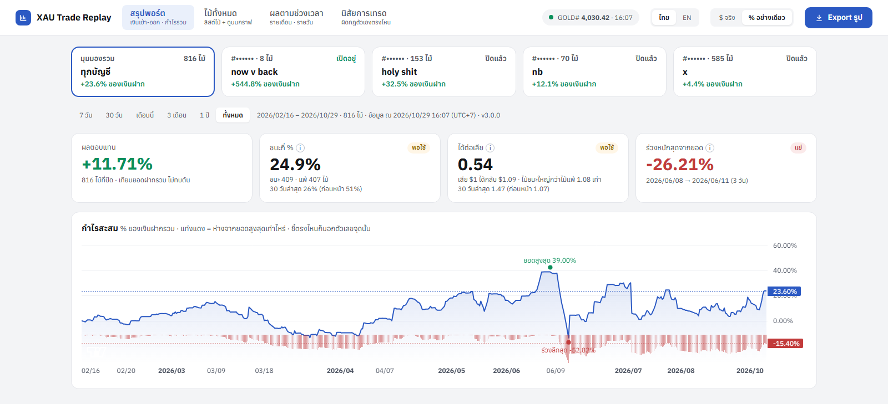
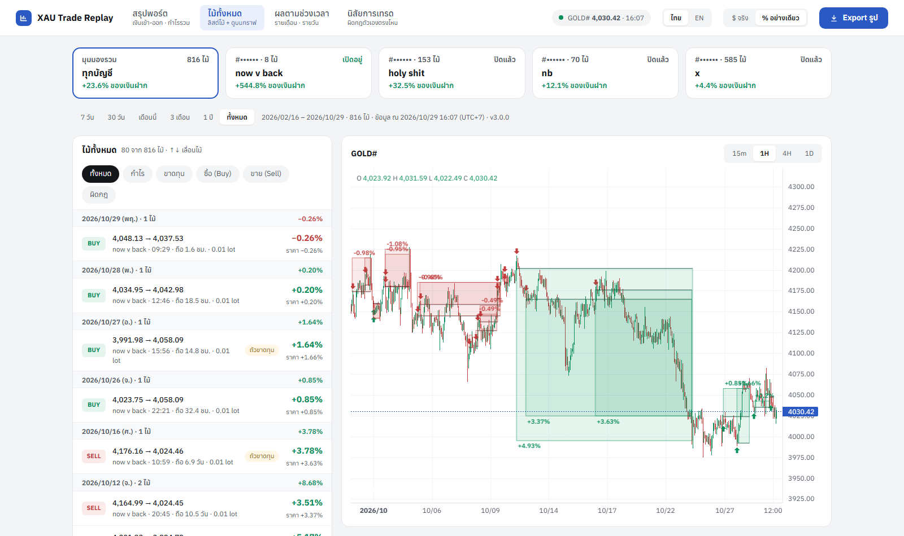
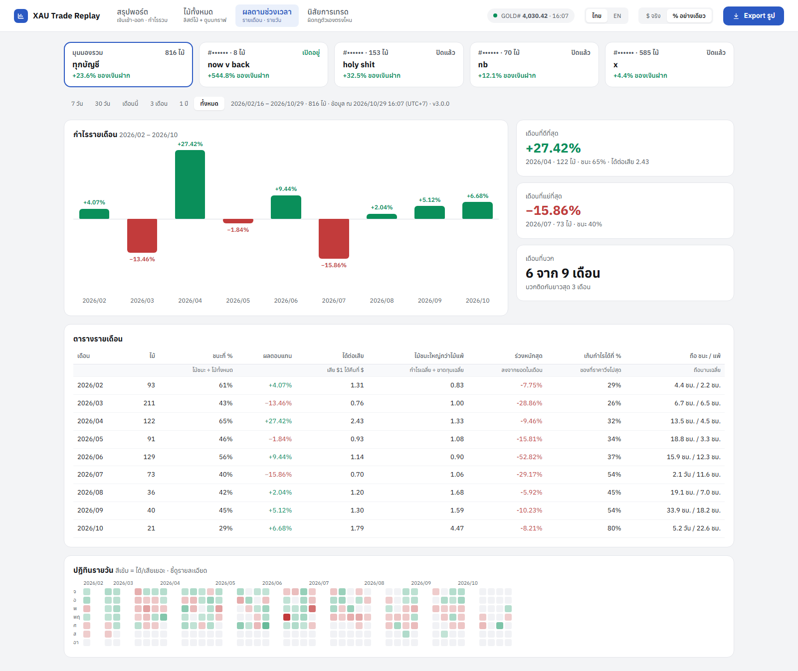
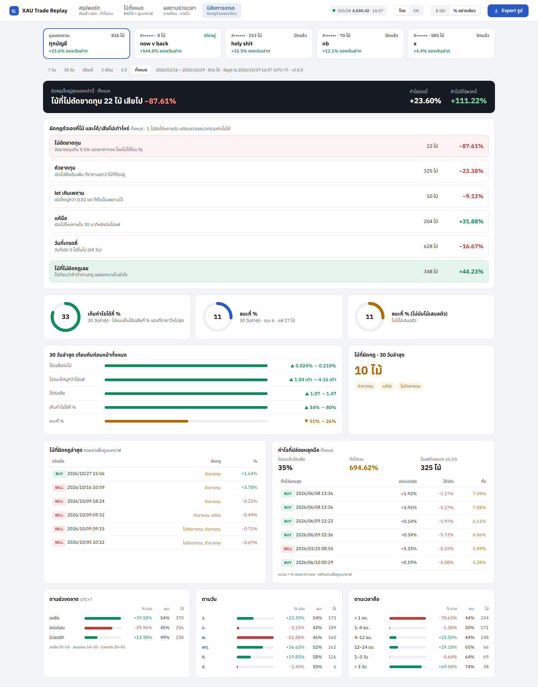

# MT5 Trade Chart

ดึงประวัติเทรดทองจาก MetaTrader 5 มาวาดเป็นกล่องบนกราฟแท่งเทียน แบบ position box ใน TradingView แล้วสรุป performance ให้ดูว่าเทรดดีตรงไหน รั่วตรงไหน

Plot your MetaTrader 5 gold trades as TradingView-style position boxes on a candlestick chart, plus a performance report that shows where you make and leak money.

| Summary · สรุปพอร์ต | All trades · ไม้ทั้งหมด |
|---|---|
|  |  |
| **By period · ผลตามช่วงเวลา** | **Habits · นิสัยการเทรด** |
|  |  |

<sub>ภาพจากพอร์ตจริงในโหมด "% อย่างเดียว" ซ่อนตัวเลขเงินและเลขบัญชี · Real account in "% only" mode, dollar amounts and account numbers hidden.</sub>

[ภาษาไทย](#ภาษาไทย) · [English](#english)

---

## ภาษาไทย

### ทำอะไรได้บ้าง
- **4 แท็บ**: สรุปพอร์ต / ไม้ทั้งหมด / ผลตามช่วงเวลา / นิสัยการเทรด
- **สรุปพอร์ต**: ฝากรวม ถอนรวม เงินในพอร์ต กำไรจริง + กราฟกำไรสะสม ชี้ดูตัวเลขทุกจุด ปักป้ายยอดสูงสุด/ร่วงลึกสุด
- **ไม้ทั้งหมด**: ลิสต์ไม้ซ้าย กราฟแท่งเทียนขวา ทุกไม้เป็นกล่องจุดเข้าถึงจุดออก สลับ TF 15m / 1H / 4H / 1D เห็น SL, TP, MFE
- **ผลตามช่วงเวลา**: กำไรรายเดือน ตารางรายเดือน (ศัพท์เป็นภาษาคน) ปฏิทินรายวัน
- **วันที่ตัวเลขล้วน** ปี/เดือน/วัน เช่น 2026/10/28 14:08
- **เลือกช่วงเวลาได้**: 7 วัน / 30 วัน / เดือนนี้ / 3 เดือน / 1 ปี / ทั้งหมด
- **MFE**: ไม้ชนะเก็บกำไรได้กี่ % ของที่ราคาเคยวิ่งให้ และมีกี่ไม้ที่เคยบวกแล้วกลับมาปิดขาดทุน
- **เช็ควินัย**: lot เกินลิมิต, ถัวขาดทุน, เปิดไม้แก้มือหลังเพิ่งแพ้, ขาดทุนหนักแบบไม่โดน SL, วันที่เทรดถี่เกิน
- **โหมด % อย่างเดียว**: ซ่อนตัวเลขเงินทั้งหมด ไว้แคปแชร์ให้คนอื่นดู
- **Export PNG**: รูปการ์ดสรุปผลขนาด 1080×1350 ขนาดโพสต์ IG/FB
- **2 ภาษา**: ไทย / อังกฤษ

### สิ่งที่ต้องมี
- Windows ที่ลงโปรแกรม **MetaTrader 5** และ login บัญชีไว้ (Python API ของ MT5 ใช้ได้บน Windows เท่านั้น)
- **Python 3.10 ขึ้นไป**

### วิธีติดตั้ง
```bat
git clone https://github.com/chenlab789/mt5-trade-chart.git
cd mt5-trade-chart
pip install -r requirements.txt
copy config.example.json config.json
```

### ตั้งค่า `config.json`
| ช่อง | ใส่อะไร | ถ้าปล่อยว่าง |
|---|---|---|
| `login` | เลขบัญชี MT5 ที่เทรดทอง | ใช้บัญชีที่ login อยู่ใน MT5 ตอนนั้น |
| `server` | ชื่อ server ของบัญชี เช่น `YourBroker-Server` (ดูได้ในหน้าต่าง login ของ MT5) | ต้องใส่ถ้าใส่ `login` |
| `symbol` | ชื่อทองใน broker ของคุณ เช่น `XAUUSD`, `GOLD#`, `XAUUSDm` | หาเองจากไม้ทองที่เทรดเยอะที่สุด |
| `utc_offset` | timezone ที่อยากให้แสดง เช่น ไทย = `7` | `7` |
| `max_lot` | lot สูงสุดต่อไม้ของคุณ ไม้ที่เกินจะโดนติดธง | `0.01` |

ถ้าใส่ `login` ไว้ แล้วตอนรัน MT5 ค้างอยู่บัญชีอื่น สคริปต์จะสลับไปบัญชีที่ตั้งไว้ ดึงข้อมูล แล้วสลับกลับให้เอง ใช้รหัสที่ MT5 จำไว้ ต้อง login บัญชีนั้นใน MT5 สักครั้งและติ๊ก **Save password** ไว้ สคริปต์ไม่เก็บรหัสผ่าน

### วิธีใช้
ดับเบิลคลิก **`open_chart.bat`** มันจะดึงข้อมูลล่าสุดจาก MT5 แล้วเปิดหน้าเว็บให้

หรือรันเอง:
```bat
python build.py
```
แล้วเปิดไฟล์ `trade_chart.html` ในเบราว์เซอร์

หน้าเว็บไม่อัปเดตเอง อยากเห็นไม้ใหม่ต้องรันใหม่ ถ้าอยากกดจากเดสก์ท็อป ให้สร้างช็อตคัทไปที่ `open_chart.bat`

### ความหมายตัวเลข
- **% ในโหมด %** คิดเทียบกับยอดเงินฝากเข้ารวมของบัญชี (คำนวณให้อัตโนมัติ) ไม่ทบต้น
- **MFE** = ระหว่างถือ ไม้เคยบวกไปไกลสุดแค่ไหน · **MAE** = เคยติดลบลึกสุดแค่ไหน (เป็น % ของราคาทอง)
- **ไม้เสมอตัว** = ราคาขยับไม่ถึง 0.05% ระหว่างเข้ากับออก
- **ถัวขาดทุน** = เปิดทิศเดิมเพิ่มที่ราคาแย่กว่าไม้ที่ถืออยู่
- **แก้มือ** = เปิดไม้ใหม่ภายใน 30 นาทีหลังปิดไม้ขาดทุน
- **หลุดไม่มีเบรก** = ปิดขาดทุนเกิน 0.5% ของราคาทองโดยไม่ได้โดน SL

### ความเป็นส่วนตัว
ข้อมูลทั้งหมดอยู่ในเครื่องคุณ ไม่มีการส่งไปที่ไหน `trade_chart.html` กับ `config.json` อยู่ใน `.gitignore` แล้ว จะไม่หลุดขึ้น git

---

## English

### Features
- **4 tabs**: Summary / All trades / By period / Habits.
- **Summary**: total deposits, withdrawals, equity and real profit, plus a cumulative P/L curve with hover values and peak / deepest-drop markers.
- **All trades**: trade list on the left, candlestick chart on the right with every trade drawn as an entry-to-exit box (15m / 1H / 4H / 1D), SL, TP and MFE.
- **By period**: monthly P/L, monthly table in plain language, daily calendar.
- **Numeric dates** everywhere, e.g. 2026/10/28 14:08.
- **Period filter**: 7 days / 30 days / this month / 3 months / 1 year / all time.
- **MFE analysis**: how much of the available move your winners kept, and how many trades were in profit before closing at a loss.
- **Discipline flags**: oversized lots, averaging down, revenge trades after a loss, large losses closed without hitting SL, overtrading days.
- **% only mode**: hides every dollar amount so you can share screenshots.
- **Export PNG**: 1080×1350 summary card, sized for Instagram/Facebook posts.
- **Thai / English** UI.

### Requirements
- Windows with the **MetaTrader 5** terminal installed and logged in (the MT5 Python API is Windows-only)
- **Python 3.10+**

### Install
```bat
git clone https://github.com/chenlab789/mt5-trade-chart.git
cd mt5-trade-chart
pip install -r requirements.txt
copy config.example.json config.json
```

### Configure `config.json`
| Field | What to put | If left empty |
|---|---|---|
| `login` | Your MT5 account number | Uses whatever account MT5 is logged into |
| `server` | The account's server name, e.g. `YourBroker-Server` (shown in the MT5 login dialog) | Required when `login` is set |
| `symbol` | Your broker's gold symbol, e.g. `XAUUSD`, `GOLD#`, `XAUUSDm` | Auto-detects the gold symbol you traded most |
| `utc_offset` | Display timezone, e.g. `7` for UTC+7 | `7` |
| `max_lot` | Your max lot size per trade; larger trades get flagged | `0.01` |

When `login` is set and MT5 is logged into a different account, the script switches to your configured account, pulls the data, and switches back. It uses the password MT5 has saved, so log in to that account once in MT5 with **Save password** ticked. The script never stores passwords.

### Usage
Double-click **`open_chart.bat`**. It pulls fresh data from MT5 and opens the report.

Or run it yourself:
```bat
python build.py
```
then open `trade_chart.html` in a browser.

The page is a snapshot and does not update on its own. Re-run to see new trades. For one-click access, create a desktop shortcut to `open_chart.bat`.

### What the numbers mean
- **% mode** returns are measured against the total amount deposited into the account (calculated automatically), non-compounded.
- **MFE** = the furthest a trade moved in your favor while open · **MAE** = the furthest it moved against you (as % of gold price)
- **Breakeven** = price moved less than 0.05% between entry and exit
- **Averaging down** = added a same-direction trade at a worse price while a position was still open
- **Revenge** = opened a new trade within 30 minutes of closing a loss
- **No-brake loss** = closed more than 0.5% of gold price in loss without hitting SL

### Privacy
Everything stays on your machine. Nothing is sent anywhere. `trade_chart.html` and `config.json` are in `.gitignore`, so they never get committed.
